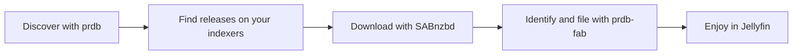

<div align="center">

# prdb-fab

**Find it. Fetch it. Build your library.**

A self-hosted library manager for Adult videos, powered by prdb and SABnzbd.

[](https://github.com/prdb-net/prdb-fab/actions/workflows/ci.yml)
[](https://hub.docker.com/r/prdbnet/prdb-fab)
[](LICENSE)

[Get started](#get-started) · [Docker guide](docs/running-in-docker.md) · [What's new](CHANGELOG.md) · [Report an issue](https://github.com/prdb-net/prdb-fab/issues)

</div>

prdb-fab turns Usenet downloads into a library you can browse in Jellyfin.
Discover videos, choose what you want, and let it find releases, send them to
SABnzbd and file the results with names, metadata and artwork.

**FaB means Fetch and Build.** Run it alongside your downloader and media server
on your NAS or home server. Configure it in your browser, then follow everything
from the first search to the finished library.

## From discovery to your library



prdb identifies releases before downloading where it can, then identifies the
files that arrive. When a file needs your decision, it waits in the **Review
queue** with the reason and available evidence.

## What you can do

| Feature | What it does for you |
| --- | --- |
| **Discover what you want** | Browse new videos, Sites and Actors with artwork and previews. Manage your favourites and Wanted list through your prdb account. |
| **Find and choose releases** | Search across your Newznab indexers, compare releases and see identification confidence before downloading. Download from a catalogue card or pick an exact release. |
| **Let Wanted do the work** | Prepare your existing collection, then automatically download a fixed selection of up to 100 recent missing Wanted videos and new recent additions. Custom rules remain available. |
| **Follow every download** | Track SABnzbd progress and failures in one place. If a release fails, prdb-fab can try another within its retry limit. |
| **Build a Jellyfin library** | Identified files move into organised folders with metadata and artwork. Metadata corrections from prdb keep the library up to date. |
| **Keep control of your files** | Review unidentified files and duplicates before deciding what happens to them. Different qualities can share one library entry; duplicates are never silently deleted. |
| **See what is happening** | Downloads, Status and the Operation log explain progress, waiting work and file changes. The browser interface adapts to desktop and mobile, with an SFW switch to blur artwork. |
| **Take your setup with you** | Export settings and library records to one backup file, then restore on a fresh installation with new storage paths. |

## Get started

You need:

- **A prdb account with a working API key** — required for setup and identification.
- **Docker Compose** on a NAS or home server, with writable storage. Images are
  built for `linux/amd64` and `linux/arm64`.
- **SABnzbd connected to a Usenet provider**, plus at least one **Newznab indexer
  with API access**, to download videos. You can add these during setup or later.
- **Jellyfin** if you want to play your finished library.

### 1. Create your Compose file

Save this as `compose.yaml`, or use the repository's
[Compose example](docker-compose.yml):

```yaml
services:
  prdb-fab:
    image: prdbnet/prdb-fab:0.24.0
    container_name: prdb-fab
    restart: unless-stopped
    ports:
      - "8080:8080"
    environment:
      PUID: "1000"
      PGID: "1000"
      UMASK: "022"
    volumes:
      - ./data:/data
      - /srv/media:/media
```

Before starting, adjust these values for your NAS:

- Set `PUID` and `PGID` to the user and group that can write to your media folders.
- Keep `./data` on the host's local storage; the database must not live on an SMB
  or NFS share.
- Replace `/srv/media` with your media folder. Create separate download and library
  directories inside it, for example `/media/downloads` and `/media/library`.
  Onboarding suggests `/media/library`; change it if your Library is mounted elsewhere.
  Mount downloads at the same container path in SABnzbd and prdb-fab where possible.

The [Docker guide](docs/running-in-docker.md) covers permissions, NAS shares,
path mapping and troubleshooting.

### 2. Start and connect

```bash
docker compose up -d
```

Open `http://your-nas:8080` in your browser, replacing `your-nas` with your
server's hostname or IP address. Set your password, connect prdb, SABnzbd and
your indexers, choose the library folder, review the collection/autopilot defaults,
and review the preview-publishing choice. Connections and preferences can be changed later in **Settings**.

Set the first password on a trusted network. Use HTTPS through a reverse proxy
if you access the application remotely.

### 3. Choose your first video

Open **What's new** or **Wanted** and choose a video. Use **Download** for the
preferred available release, or open **Releases** to compare and choose one.
The initial catalogue and indexer sync runs in the background; **Status** shows
its progress. Use **Search Indexers** on a video to request a search.

Fresh setup prepares the existing collection before starting **Recent Wanted
autopilot**. Review the proposed moves on Wanted; approved files leave their
source and enter the sorted Library. Empty storage needs no import confirmation.
The supplied policy selects up to the newest 100 eligible missing Wanted videos
released within 90 UTC calendar dates, then admits new recent Wanted intent.
The initial selection is never refilled. You can opt out during setup or switch
the policy off in **Settings → Automation**. Existing installations keep their
current behavior and can adopt it explicitly there. See [how automation works](docs/automation.md).

## A few things to know

- **Files are moved into the library.** Across filesystems, prdb-fab verifies
  the copy before removing the source. Keep downloads and the library on the
  same filesystem for faster filing.
- **Reporting is configurable.** The three reporting switches are on by
  default: Wanted fulfilments, manually confirmed file assignments and published
  previews. Preview publishing only starts after you save the explanation form;
  previews can become public on prdb, and accepted submissions cannot be
  retracted through prdb-fab. Review [what is sent](docs/privacy.md) during setup.
- **Back up configuration and media separately.** The backup file includes
  readable API keys and settings, but no video files. Store it securely and let
  your backup software encrypt it.
- **This is pre-1.0 software.** Pin a release, read the [changelog](CHANGELOG.md)
  and copy `/data` before updating. Database migrations only go forward.

## Learn more

| I want to… | Start here |
| --- | --- |
| Install, update, back up or troubleshoot | [Running in Docker](docs/running-in-docker.md) |
| Set up unattended downloads | [Automation](docs/automation.md) |
| Understand reporting and preview publishing | [Privacy](docs/privacy.md) · [Publishing previews](docs/publishing-previews.md) |
| Understand search, identification and filing | [How it works](docs/how-it-works.md) |
| See recent changes | [Changelog](CHANGELOG.md) |
| Contribute or run from source | [Contributing](CONTRIBUTING.md) · [Project vision](VISION.md) |

Found a bug or have an idea? [Open an issue](https://github.com/prdb-net/prdb-fab/issues)
with your version, what you expected and what happened. Never attach a backup
file or API keys. Code contributions are welcome too.

prdb-fab is open source under the [MIT license](LICENSE).
